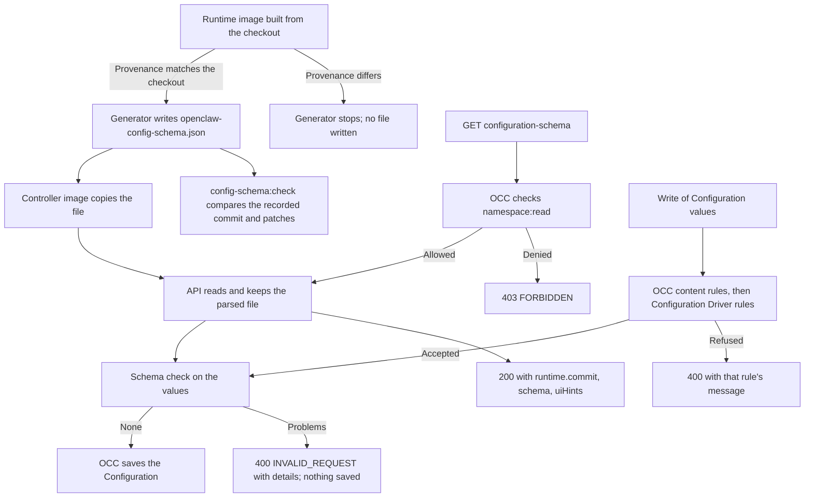

# How OCC serves and applies the Agent configuration schema

## Overview

OpenClaw Control Plane (OCC) serves the configuration JSON Schema and display
hints of the OpenClaw runtime that its source pins. A contributor generates them
from a runtime image into one committed file. The controller image carries that
file. The API reads it for a caller who can read the Namespace, and passes a
check against it to OCC with each write of Configuration values. The flow stops
when the API sends the schema or refuses the write. The runtime validates the
deployed document itself when it starts.

## Entry Points

- A contributor regenerates the file after a change to the pinned OpenClaw
  commit or a carried patch. `scripts/generate-runtime-config-schema.ts:generate`
- A caller with `namespace:read` sends
  `GET /namespaces/{namespaceId}/agents/configuration-schema`.
  `apps/controller/src/http/agents.ts:getAgentConfigurationSchema`
- A caller creates or updates a Configuration, provisions an Agent, or checks an
  Agent create. `apps/controller/src/http/configurations.ts:createConfiguration`

## Flow

## Execution Trace

### 1. Generate the file from a runtime image

`scripts/generate-runtime-config-schema.ts:generate`

The generator reads `/opt/oce/runtime/provenance.json` from the selected image.
It compares the recorded OpenClaw commit and the SHA-256 of each patch with
`deploy/runtime/openclaw-source.json` and the `deploy/runtime/*.patch` files in
the checkout. A difference stops the run before any write, because a carried
patch can change the schema as the commit can.

The generator then runs two commands in the image without network access.
`openclaw config schema` prints the JSON Schema, which includes the settings of
the plugins and channels in the image. A short module imports the image's
`buildConfigSchemaCore()` and prints its `uiHints`, because the schema command
omits them. The generator writes `deploy/runtime/openclaw-config-schema.json`
with three members: `openclaw` (commit and patch digests), `schema`, and
`uiHints`. It writes one line for each top-level setting and each hint path.

### 2. Detect a stale file

`scripts/generate-runtime-config-schema.ts:runtimeConfigSchemaStaleness`

`pnpm config-schema:check` compares the `openclaw` member with the checkout and
needs no image. `tests/integration/runtime-assets.test.ts` runs the same
comparison, and `tests/integration/console-api.test.ts` compares the served
commit with the pin. A changed pin or patch without a new file fails these checks.

### 3. Package and load the file

`apps/controller/src/admission/runtime-configuration-schema.ts:loadRuntimeConfigurationSchema`

The development and runtime stages of the controller `Dockerfile` copy the file
to `/app/deploy/runtime/openclaw-config-schema.json`. The controller image build
does not read the runtime image. The loader resolves the same path relative to
its source file, so a checkout and the image use one location. It reads and
parses the file on the first call and returns the same object afterwards.

### 4. Authorize and answer the read

`apps/controller/src/http/agents.ts:getAgentConfigurationSchema`

The handler calls `OpenClawController.getNamespace`, which requires
`namespace:read` on the Namespace in the path and returns `403 FORBIDDEN`
without it. The handler records the Namespace as the audit read target, then
sends `runtime.commit`, `schema`, and `uiHints` from the loader. The response
has the default API headers, which include `Cache-Control: no-store`. The answer
does not depend on the Namespace. The caller owns any use of the schema.

### 5. Check values on a write

`packages/occ/src/index.ts:requireCheckedValues`

The handlers for Configuration create and update, Agent provisioning, and the
Agent create check pass `checkRuntimeConfigurationValues` to the OCC method they
call. OCC has no file access, so the API supplies the check, as it supplies the
Harness resolver. OCC authorizes the caller first. It then runs
`validateConfigurationContent` and the Configuration Driver's `validate`, and
calls the supplied check last. A value that an OCC rule refuses therefore keeps
that rule's message, for example the replacement for a retired setting.
Preset save, deployment, and the worker pass no check.

`apps/controller/src/admission/runtime-configuration-schema.ts:runtimeConfigurationProblems`
walks the values and the schema together. It reports a key that a closed object
does not list, a wrong type, a value outside `const` or `enum`, and a number
outside its bounds. A union accepts a value that one branch accepts. The walk
does not evaluate `required`, text patterns, formats, lengths, `not`, `if`, or
`$ref`, because the runtime fills defaults and replaces `${NAME}` references
before it validates. A string that holds such a reference is checked for its
type only.

When the check returns problems, OCC throws `ConfigurationValuesError` before it
writes metadata or calls the Driver's `create` or `update`. Each problem path
gets the JSON Pointer of the values in the request body as a prefix.
`apps/controller/src/http/errors.ts:requestFailure` maps the error to
`400 INVALID_REQUEST` with the first problem as the message and at most 32
details. The caller corrects the named settings and sends the request again.

## Debugging and Verification

- `pnpm config-schema:check` exits with a message that names the differing
  commit or patch. Rebuild the runtime image from the checkout, then run
  `pnpm config-schema:generate --image <reference>`.
- `node --test --test-name-pattern="Agent configuration schema" tests/integration/console-api.test.ts`
  reads the route through the controller with Native IAM. It proves the
  permission and the response contract. It does not prove that a deployed
  runtime image has the same source.
- A refused write returns `details` whose `path` starts with `/values` or
  `/configuration/values`. Find that path in the served schema to see what the
  setting accepts.
  `node --test --test-name-pattern="pinned runtime schema rejects" tests/integration/agent-create-validate-api.test.ts`
  proves the refusal and the acceptance of a `${NAME}` reference through the
  real routes. `tests/conformance/runtime-configuration-schema.test.ts` proves
  that the bundled Presets and the settings OCC writes pass the pinned schema.
  Neither proves what a deployed runtime image accepts.
- The read fails with a server error when the controller image does not contain
  the file. Check the `COPY` lines in the `Dockerfile`.

## Related docs

- [Agent configuration schema reference](../reference/configuration/runtime-schema.md)
- [Configuration Driver flow](configuration-driver.md)
- [Runtime image recipe](../../deploy/runtime/README.md)
- [Pin-update recipe](../../.agents/skills/oce-cookbook/references/update-openclaw-pin.md)

## Manual Notes

[keep this for the user to add notes. do not change between edits]

## Changelog

- 2026-11-20 15:09: Add the schema check that OCC runs last on a write of Configuration values, and its refusal (authoring-run/c04631cd-e5bd-4e09-8896-86622e739cb1 - 2bfa7986f31ae485479c5e8eec4c89b763aeddec)
- 2026-11-20 14:18: Document schema generation, the staleness check, and the read route added with this change (authoring-run/5e465a02-4a1b-46a6-bc69-dca7d7862318 - 5bf2ae7fd703197701f311098d734a10ed4ab593)
